<a href="https://www.sajidur.me">
<picture>
  <source media="(prefers-color-scheme: dark)" srcset="assets/header-dark.svg">
  <source media="(prefers-color-scheme: light)" srcset="assets/header-light.svg">
  
</picture>
</a>

<a href="https://www.sajidur.me"><picture><source media="(prefers-color-scheme: dark)" srcset="assets/nav-portfolio-dark.svg"><source media="(prefers-color-scheme: light)" srcset="assets/nav-portfolio-light.svg"></picture></a> <a href="https://www.sajidur.me/resume"><picture><source media="(prefers-color-scheme: dark)" srcset="assets/nav-resume-dark.svg"><source media="(prefers-color-scheme: light)" srcset="assets/nav-resume-light.svg"></picture></a> <a href="https://www.linkedin.com/in/sajidur-rahman-sajid/"><picture><source media="(prefers-color-scheme: dark)" srcset="assets/nav-linkedin-dark.svg"><source media="(prefers-color-scheme: light)" srcset="assets/nav-linkedin-light.svg"></picture></a> <a href="mailto:sajidsajidurrahman99@gmail.com"><picture><source media="(prefers-color-scheme: dark)" srcset="assets/nav-email-dark.svg"><source media="(prefers-color-scheme: light)" srcset="assets/nav-email-light.svg"></picture></a>

I build full-stack products and the AI systems behind them, from voice calls to student records.

<picture>
  <source media="(prefers-color-scheme: dark)" srcset="assets/track-dark.svg">
  <source media="(prefers-color-scheme: light)" srcset="assets/track-light.svg">
  
</picture>

<picture>
  <source media="(prefers-color-scheme: dark)" srcset="assets/now-dark.svg">
  <source media="(prefers-color-scheme: light)" srcset="assets/now-light.svg">
  
</picture>

<a href="https://voicecon.app/">
<picture>
  <source media="(prefers-color-scheme: dark)" srcset="assets/card-voicecon-dark.svg">
  <source media="(prefers-color-scheme: light)" srcset="assets/card-voicecon-light.svg">
  
</picture>
</a>

<a href="https://neuro-screen.streamlit.app/"><picture>
  <source media="(prefers-color-scheme: dark)" srcset="assets/card-neuro-screen-dark.svg">
  <source media="(prefers-color-scheme: light)" srcset="assets/card-neuro-screen-light.svg">
  
</picture></a>
<a href="https://www.sajidur.me/#projects"><picture>
  <source media="(prefers-color-scheme: dark)" srcset="assets/card-lumifi-sms-dark.svg">
  <source media="(prefers-color-scheme: light)" srcset="assets/card-lumifi-sms-light.svg">
  
</picture></a>

[VoiceCon case study](https://www.sajidur.me/projects/voicecon) &nbsp;|&nbsp; [Neuro-Screen repo](https://github.com/Saji-d/neuro-screen) &nbsp;|&nbsp; [InvoicePilot](https://www.sajidur.me/projects/invoicepilot) &nbsp;|&nbsp; [FUMAK](https://fumak-inventory.vercel.app/) &nbsp;|&nbsp; [All projects](https://www.sajidur.me/#projects)

<picture>
  <source media="(prefers-color-scheme: dark)" srcset="assets/stack-dark.svg">
  <source media="(prefers-color-scheme: light)" srcset="assets/stack-light.svg">
  
</picture>

<picture>
  <source media="(prefers-color-scheme: dark)" srcset="assets/activity-dark.svg">
  <source media="(prefers-color-scheme: light)" srcset="assets/activity-light.svg">
  
</picture>

<a href="mailto:sajidsajidurrahman99@gmail.com">
<picture>
  <source media="(prefers-color-scheme: dark)" srcset="assets/footer-dark.svg">
  <source media="(prefers-color-scheme: light)" srcset="assets/footer-light.svg">
  
</picture>
</a>

[sajidsajidurrahman99@gmail.com](mailto:sajidsajidurrahman99@gmail.com) &nbsp;|&nbsp; [sajidur.me](https://www.sajidur.me) &nbsp;|&nbsp; Dhaka, Bangladesh (UTC+6)

