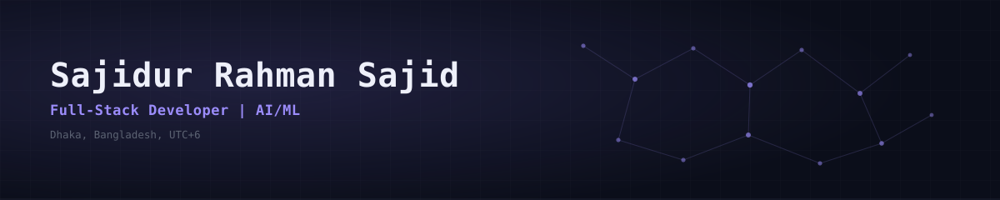

<div align="center">

<picture>
  <source media="(prefers-color-scheme: dark)" srcset="assets/banner-dark.svg">
  <source media="(prefers-color-scheme: light)" srcset="assets/banner-light.svg">
  
</picture>


<p align="center">
<a href="mailto:sajidsajidurrahman99@gmail.com"></a>
</p>

<p align="center">
<a href="https://sajidur.me"></a>
<a href="https://github.com/Saji-d"></a>
<a href="https://www.linkedin.com/in/sajidur-rahman-sajid/"></a>
<a href="mailto:sajidsajidurrahman99@gmail.com"></a>
</p>

<p align="center">

</p>

</div>


## `> whoami`

```python
class Sajid:
    role      = "Full-Stack Developer"
    now       = ["2BitSoft (Dubai)", "RemoteIntegrity (USA, contract)"]
    building  = "VoiceCon: realtime AI voice calling"
    focus     = ["Full-Stack Engineering", "Applied AI/ML", "Backend Systems"]
    education = "BSc CSE, AIUB (3.91 / 4.00)"
    base      = "Dhaka, Bangladesh · UTC+6"
```

I build full-stack software and production-oriented AI/ML systems, from data pipelines and model training to APIs, databases, mobile apps, and the interfaces people use. Most of that work sits where backend engineering meets applied AI.


## `> focus`

<table width="100%">
<tr>
<td width="33%" align="center" valign="top">

**◈ AI / ML**
<br/>
`Voice Conversion` `OCR` `NLP` `RAG` `Computer Vision`

</td>
<td width="33%" align="center" valign="top">

**◈ Backend**
<br/>
`APIs` `Realtime` `Pipelines` `Databases` `Auth`

</td>
<td width="33%" align="center" valign="top">

**◈ Full-Stack & Mobile**
<br/>
`React` `Next.js` `TypeScript` `Kotlin` `Compose`

</td>
</tr>
</table>


## `> currently`

```text
┌─ WORKING WITH ─────────────────────────────────────────────────────────────┐
│  2BitSoft          Full-Stack Developer   Dubai, UAE        since Oct 2026 │
│  RemoteIntegrity   Full-Stack Developer   USA · contract    since Oct 2026 │
└────────────────────────────────────────────────────────────────────────────┘
┌─ BUILDING & SHIPPED ───────────────────────────────────────────────────────┐
│  VoiceCon      Android-first AI voice calling with realtime voice          │
│                conversion: Kotlin app, Fastify + Prisma API, Twilio        │
│                media streams, Seed-VC on GPU                               │
│  InvoicePilot  AI invoice processing: OCR, validation, duplicate and       │
│                anomaly detection                                           │
└────────────────────────────────────────────────────────────────────────────┘
```


## `> projects`

**VoiceCon** · `in development`
Android-first AI voice calling. A caller's live speech is converted in real time into an authorized voice profile on a GPU (Seed-VC) and delivered to the recipient over a Twilio PSTN call, using a two-leg media bridge that fails closed so raw audio is never forwarded. Includes a Kotlin app, a billing-aware backend, an admin panel, and a realtime gateway.
`Kotlin` `Jetpack Compose` `Fastify` `Prisma` `PostgreSQL` `Twilio` `Python` `PyTorch` `Seed-VC` `React`

**InvoicePilot** · `shipped`
AI-powered invoice processing platform, built by a team at Ledgercross. My part was the AI extraction service: an 11-stage pipeline that extracts, validates, and normalizes invoice data via OCR, then flags duplicates and anomalies before it reaches the API.
`FastAPI` `Python` `Mindee OCR` `PostgreSQL` `Redis Streams`

**[Fumak Inventory Management](https://github.com/Saji-d/fumak-inventory)** · [`live`](https://fumak-inventory.vercel.app)
Inventory and point-of-sale system running in an active retail business, with barcode scanning across a native Android app and a web admin console.
`Kotlin` `Jetpack Compose` `Next.js` `Neon PostgreSQL` `Prisma`

**[CaseVault](https://github.com/Saji-d/casevault)** · [`live`](https://casevault-bd.vercel.app)
Legal document search for Bangladeshi law: FastAPI keyword search over 46 statutes and judgements with a Next.js frontend.
`FastAPI` `Python` `Next.js` `TypeScript`

**[Mini Kanban Board](https://github.com/Saji-d/mini-kanban-board)** · [`live`](https://mini-kanban-board-frontend.vercel.app)
Production-minded Kanban board with authentication, role-based collaboration, secure authorization, and drag-and-drop task reordering.
`Next.js` `NestJS` `PostgreSQL` `Prisma` `Docker`

**[LedgerTurf](https://github.com/Saji-d/ledgerturf)** · [`live`](https://ledgerturf.vercel.app)
Turf booking platform. Players discover and reserve grounds on a Google Map; turf locations carry a MongoDB 2dsphere index.
`React` `Express` `MongoDB` `Google Maps`

**[FinBERT Financial Sentiment](https://github.com/Saji-d/financial-sentiment-analysis-bert)** · `NLP`
Comparative study showing a domain-tuned transformer outperforms generic sentiment models on financial text.
`BERT` `Transformers` `PyTorch`


## `> research`

**[Neuro-Screen](https://github.com/Saji-d/neuro-screen)** · [`live demo`](https://neuro-screen.streamlit.app) · hybrid CatBoost + ANN ensemble for cognitive-impairment risk screening in insomniac university students. 2,237 survey responses, 95.2% accuracy, 0.982 ROC-AUC.

**Explainable Bangla Toxic Comment Detection** · BanglaBERT fine-tuned for toxicity detection in Bengali text, IEEE-format paper. 86% accuracy, 0.91 ROC-AUC, 5-fold cross-validation.

**Early Warning Model for High-Value Customer Drop-Off** · RFM feature engineering, K-Means segmentation, and Random Forest on the UCI Online Retail dataset. Segments 4,338 customers; the early-risk model reaches 0.79 ROC-AUC on the 776 high-value customers.


## Tech Stack

<div align="center">

**Languages**


**AI / ML**


**Systems, Data & Web3**


**Also**


</div>

## GitHub Analytics

<div align="center">

</div>

<div align="center">


</div>

<div align="center">


<br/>


</div>

## `> experience`

```text
2026 ─●─ 2BitSoft ········· Full-Stack Developer ······ Dubai, UAE ···· Oct 2026 – Present
      ●─ RemoteIntegrity ·· Full-Stack (Contract) ····· Florida, USA ·· Oct 2026 – Present
      ●─ Ledgercross ······ Software Developer ········ Dhaka, BD ····· May 2026 – Sep 2026
      ●─ BSS ·············· Software Engineer Intern ·· Dhaka, BD ····· Feb 2026 – Apr 2026
```

**2BitSoft** · Full-stack web applications for software, automation, and digital transformation projects.
**RemoteIntegrity LLC** · Front-end and back-end web application work: server-side logic, APIs, database integrations, testing, and deployment.
**Ledgercross** · Production software across the stack for enterprise finance: REST APIs, async processing, automated testing, and cloud infrastructure.
**BSS** · Responsive frontend interfaces with HTML5, CSS3, and JavaScript, integrated with RESTful APIs.

## `> education`

```text
┌─ BSc · COMPUTER SCIENCE & ENGINEERING ────────────────────────────────┐
│  American International University-Bangladesh                         │
│                                                                       │
│  2022 ────────────────────────●──────────────────────── 2026          │
│                                                                       │
│  CGPA   ███████████████████████████░   3.91 / 4.00                    │
│                                                                       │
│  5x Dean's Award   ·   AIUB Merit Scholar (up to 70% tuition waiver)  │
└───────────────────────────────────────────────────────────────────────┘
```


<div align="center">

## `> availability`

Open to full-stack, platform, and applied ML roles, plus select freelance and product work.

**Reach me:** [sajidsajidurrahman99@gmail.com](mailto:sajidsajidurrahman99@gmail.com)

[`Portfolio`](https://sajidur.me) · [`GitHub`](https://github.com/Saji-d) · [`LinkedIn`](https://www.linkedin.com/in/sajidur-rahman-sajid/) · [`Email`](mailto:sajidsajidurrahman99@gmail.com)

</div>
