<a href="https://www.sajidur.me">
<picture>
  <source media="(prefers-color-scheme: dark)" srcset="assets/header-dark.svg">
  <source media="(prefers-color-scheme: light)" srcset="assets/header-light.svg">
  
</picture>
</a>

**[Portfolio](https://www.sajidur.me)** &nbsp;·&nbsp; **[Resume](https://www.sajidur.me/resume)** &nbsp;·&nbsp; **[LinkedIn](https://www.linkedin.com/in/sajidur-rahman-sajid/)** &nbsp;·&nbsp; **[Email](mailto:sajidsajidurrahman99@gmail.com)**

I build full-stack products and the AI systems that sit behind them. Most of my work is where a tidy interface meets a messy backend: an Android app that places a phone call in someone else's voice, a service that decides whether an invoice looks wrong, a student system where one college must never see another's records.

I like software that fails in a way you decided on in advance. VoiceCon ends the call before it forwards raw audio, and my research prototype below reports a result that did not flatter the model.

I finished a BSc in Computer Science and Engineering at AIUB (CGPA 3.91 / 4.00) in April 2026 and have been shipping professionally since.

## Now

| | Role | What I am doing |
|---|---|---|
| **Lumifi Solutions** (Australia) | Full-Stack Developer, remote, since Nov 2026 | Building a multi-tenant student management system for Australian training organisations (RTOs) on Next.js, TypeScript, Drizzle ORM and PostgreSQL. I own the Applications and Enrolments module. Also an early-stage business site and resume bank for the Bangladesh market (World Bridge, in progress). |
| **RemoteIntegrity LLC** (USA) | Full-Stack Developer, contract, since Oct 2026 | Front-end and back-end components, APIs and database integrations for client web applications, through code review, testing and deployment. |

Before that: **Ledgercross**, Dhaka (May to Sep 2026). I built the FastAPI OCR and fraud service for InvoicePilot and delivered FUMAK, a barcode inventory and POS system for a real shop, as the only developer.

## Selected work

<a href="https://voicecon.app/">
<picture>
  <source media="(prefers-color-scheme: dark)" srcset="assets/card-voicecon-dark.svg">
  <source media="(prefers-color-scheme: light)" srcset="assets/card-voicecon-light.svg">
  
</picture>
</a>

<a href="https://neuro-screen.streamlit.app/">
<picture>
  <source media="(prefers-color-scheme: dark)" srcset="assets/card-neuro-screen-dark.svg">
  <source media="(prefers-color-scheme: light)" srcset="assets/card-neuro-screen-light.svg">
  
</picture>
</a>
<a href="#now">
<picture>
  <source media="(prefers-color-scheme: dark)" srcset="assets/card-lumifi-sms-dark.svg">
  <source media="(prefers-color-scheme: light)" srcset="assets/card-lumifi-sms-light.svg">
  
</picture>
</a>

<table>
<tr>
<td width="33%" valign="top">

**VoiceCon** &nbsp;[live](https://voicecon.app/) · [case study](https://www.sajidur.me/projects/voicecon)

A Kotlin app, a Fastify and Prisma billing API, a React admin panel, a Python media gateway and a Seed-VC GPU worker, joined through Twilio. The recipient only hears what the worker sends back, and if the worker errors the bridge clears its queue and ends the call.

Measured on an RTX A5000 (6 diffusion steps, 180 ms blocks, 5-minute run): p50 inference about 86 ms, real-time factor 0.50, no audio dropped.

</td>
<td width="33%" valign="top">

**Neuro-Screen** &nbsp;[live demo](https://neuro-screen.streamlit.app/) · [repo](https://github.com/Saji-d/neuro-screen)

A Streamlit prototype that screens survey answers for cognitive-impairment risk in university students, from a group research project at AIUB. The app and the re-analysis are my work.

Re-checking the original pipeline I found target leakage and removed it. With 5-fold nested cross-validation, accuracy equals the majority baseline and ROC-AUC is 0.48. I kept that result because it is the true one.

</td>
<td width="33%" valign="top">

**Lumifi SMS** &nbsp;(private, company work)

Per-college tenancy with row-level scoping, and tests that check one college cannot read another's data.

My module covers Applications and Enrolments: one shared form and validation for public, staff and agent entry, saved drafts, generated Offer IDs, admin-configurable fields, documents and Student ID format, offer-letter versioning and CSV bulk import. It is backed by integration tests and WCAG contrast, motion and responsive audits.

</td>
</tr>
</table>

Also: **[InvoicePilot](https://www.sajidur.me/projects/invoicepilot)**, a team-built invoice platform where I wrote the AI extraction service (an 11-stage OCR pipeline with 9 fraud rules, 19 anomaly rules and 246 pytest tests), and **[FUMAK](https://fumak-inventory.vercel.app/)**, the inventory and POS system for a real retail shop. More on the [portfolio](https://www.sajidur.me/#projects).

## Stack

<picture>
  <source media="(prefers-color-scheme: dark)" srcset="assets/stack-dark.svg">
  <source media="(prefers-color-scheme: light)" srcset="assets/stack-light.svg">
  
</picture>

## Research

I write up what I measure, including when it is disappointing.

| Study | Result |
|---|---|
| Neuro-Screen, cognitive-impairment screening (AIUB group project) | After removing target leakage, 5-fold nested CV gives 62.1% accuracy (the majority baseline) and ROC-AUC 0.48. A negative result, with the leakage found and documented. |
| Explainable Bangla toxic comment detection | BanglaBERT with SHAP and LIME: 86% accuracy, 0.91 ROC-AUC, 5-fold stratified CV. |
| Early-warning model for high-value customer drop-off | RFM profiling and clustering on 4,338 customers, with a Random Forest at 0.788 ROC-AUC. |
| Water turbidity from phone photos | EfficientNet-B0 fine-tuned on 300+ self-collected images, with an honest account of how hard field generalisation is. |

## Activity

<picture>
  <source media="(prefers-color-scheme: dark)" srcset="assets/activity-dark.svg">
  <source media="(prefers-color-scheme: light)" srcset="assets/activity-light.svg">
  
</picture>

 

<picture>
  <source media="(prefers-color-scheme: dark)" srcset="assets/footer-dark.svg">
  <source media="(prefers-color-scheme: light)" srcset="assets/footer-light.svg">
  
</picture>

[sajidsajidurrahman99@gmail.com](mailto:sajidsajidurrahman99@gmail.com) &nbsp;·&nbsp; [sajidur.me](https://www.sajidur.me) &nbsp;·&nbsp; [LinkedIn](https://www.linkedin.com/in/sajidur-rahman-sajid/) &nbsp;·&nbsp; Dhaka, Bangladesh (UTC+6)

