<a href="https://www.sajidur.me"><picture><source media="(max-width: 600px)" srcset="assets/header-m.svg">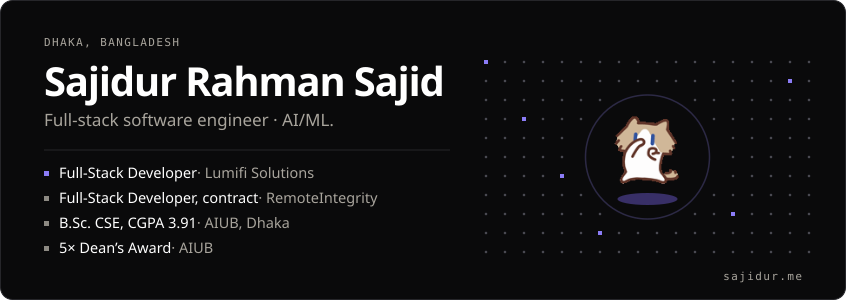</picture></a>

I'm **Sajidur Rahman Sajid**, a full-stack software engineer in Dhaka, Bangladesh. I'm a developer at [Lumifi Solutions](https://www.sajidur.me/projects/lumifi-sms) and a contract developer at [RemoteIntegrity](https://www.sajidur.me/projects/aria-erp), and I hold a B.Sc. in Computer Science and Engineering from AIUB. I build web and mobile systems, with AI/ML as a specialty: realtime voice conversion, document extraction and applied machine learning.

**Website: [sajidur.me](https://www.sajidur.me)** · [About me](https://www.sajidur.me/about) · [Case studies](https://www.sajidur.me/projects) · [Résumé](https://www.sajidur.me/resume) · [Research](https://www.sajidur.me/research/neuronscreen)

<a href="mailto:sajidsajidurrahman99@gmail.com"><picture><source media="(max-width: 600px)" srcset="assets/available-m.svg">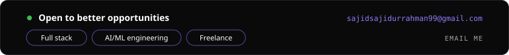</picture></a>

<a href="https://www.sajidur.me"><picture><source media="(max-width: 600px)" srcset="assets/stats-m.svg">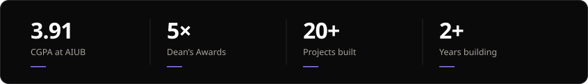</picture></a>

<a href="https://github.com/Saji-d?tab=repositories&sort=pushed"><picture><source media="(max-width: 600px)" srcset="assets/now-m.svg">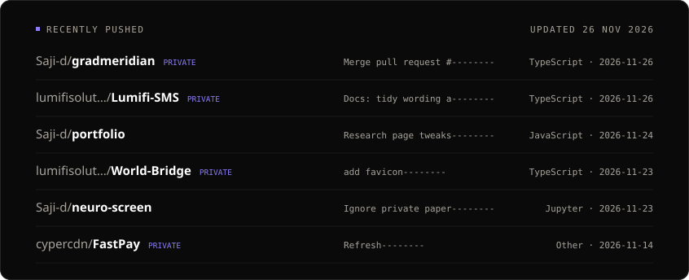</picture></a>

<a href="https://www.sajidur.me/projects/lumifi-sms"><picture><source media="(max-width: 600px)" srcset="assets/role-lumifi-m.svg">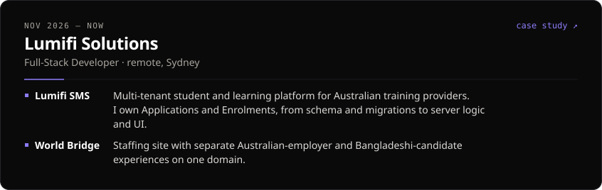</picture></a>

<a href="https://www.sajidur.me/projects/aria-erp"><picture><source media="(max-width: 600px)" srcset="assets/role-remoteintegrity-m.svg">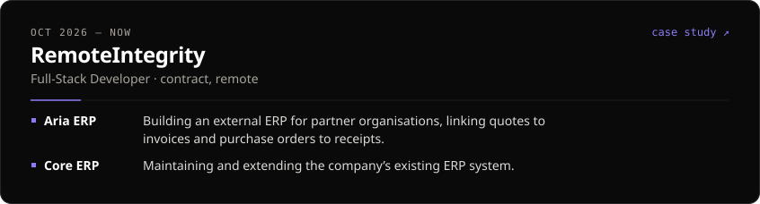</picture></a>

<a href="https://www.sajidur.me/projects"><picture><source media="(max-width: 600px)" srcset="assets/role-ledgercross-m.svg">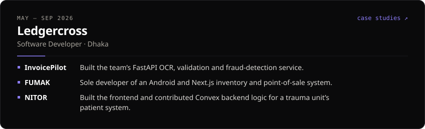</picture></a>

<a href="https://www.sajidur.me/#experience"><picture><source media="(max-width: 600px)" srcset="assets/role-bss-m.svg">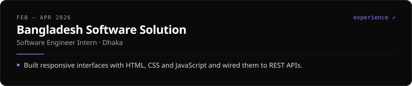</picture></a>

<a href="https://voicecon.app/">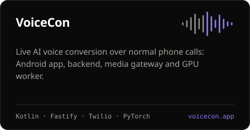</a>
<a href="https://fumak-inventory.vercel.app/">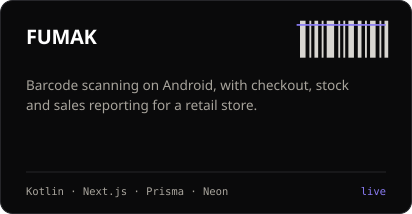</a>
<a href="https://github.com/Saji-d/casevault">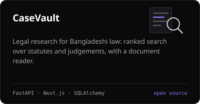</a>
<a href="https://github.com/Saji-d/ledgerturf">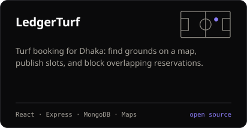</a>

Case studies: [VoiceCon](https://www.sajidur.me/projects/voicecon) · [InvoicePilot](https://www.sajidur.me/projects/invoicepilot) · [Lumifi SMS](https://www.sajidur.me/projects/lumifi-sms) · [World Bridge](https://www.sajidur.me/projects/world-bridge) · [Aria ERP](https://www.sajidur.me/projects/aria-erp). Live: [CaseVault](https://casevault-bd.vercel.app/) · [LedgerTurf](https://ledgerturf.vercel.app/) · [NITOR](https://dr-stone.vercel.app/)

<a href="https://www.sajidur.me/research/neuronscreen"><picture><source media="(max-width: 600px)" srcset="assets/research-m.svg">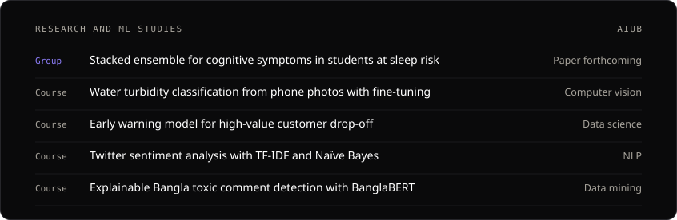</picture></a>

Neuro-Screen: [study](https://www.sajidur.me/research/neuronscreen) · [code](https://github.com/Saji-d/neuro-screen) · [app](https://neuro-screen.streamlit.app/). I built the Streamlit app and ran the re-analysis for our AIUB group.

<a href="https://github.com/Saji-d">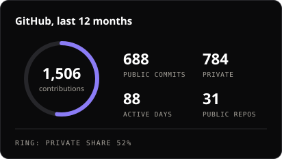</a>
<a href="https://github.com/Saji-d?tab=repositories">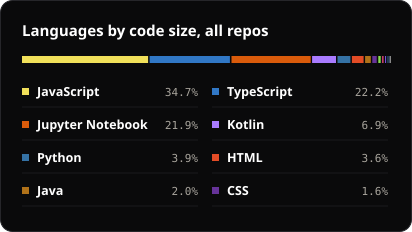</a>

<picture><source media="(max-width: 600px)" srcset="assets/iso-m.svg">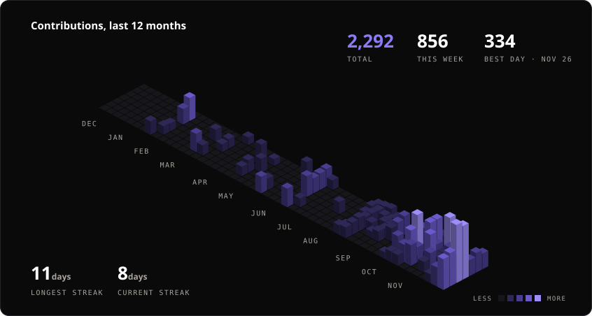</picture>

<picture><source media="(max-width: 600px)" srcset="assets/grid-m.svg">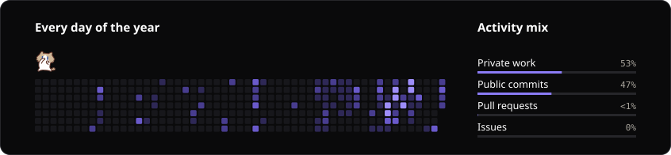</picture>

<a href="https://www.sajidur.me"><picture><source media="(max-width: 600px)" srcset="assets/footer-m.svg">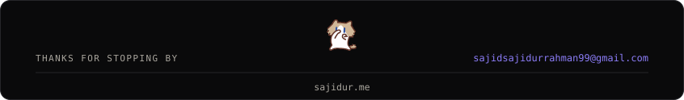</picture></a>
