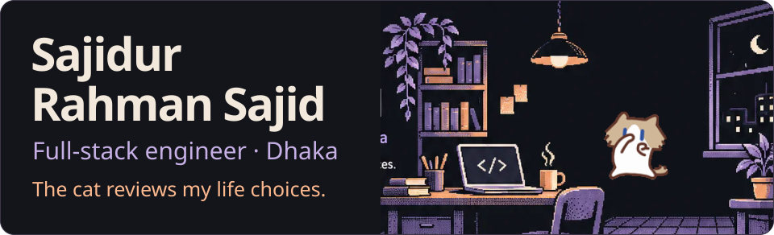
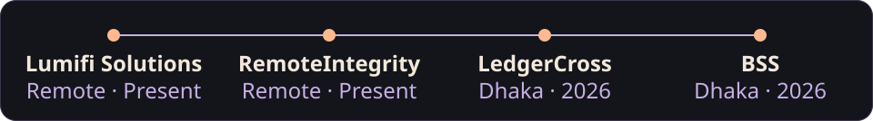
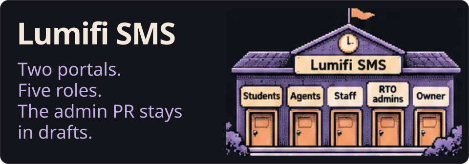
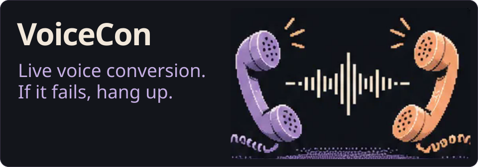
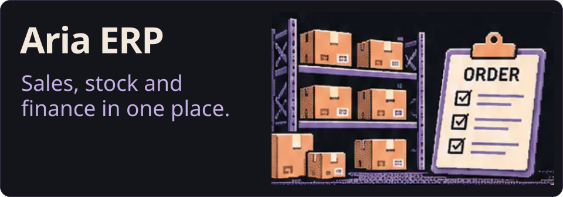
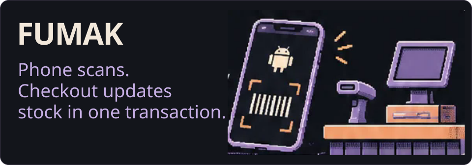
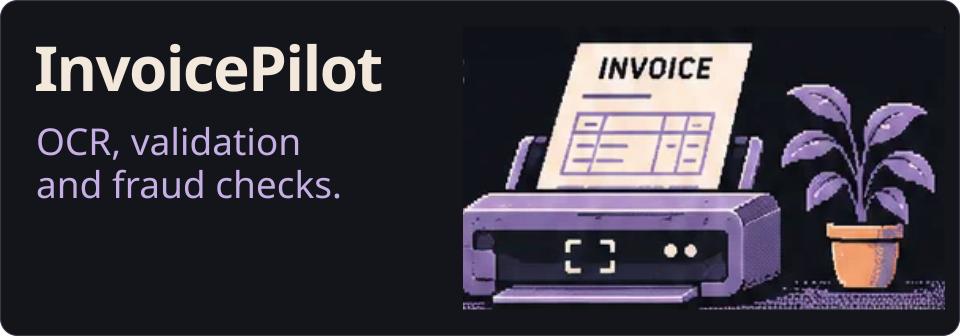
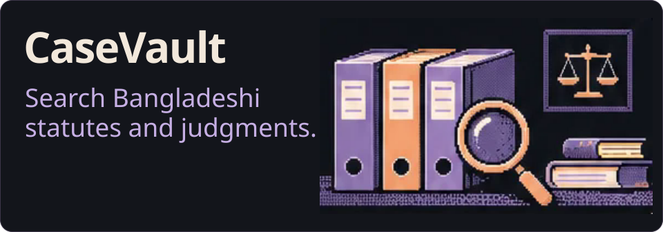
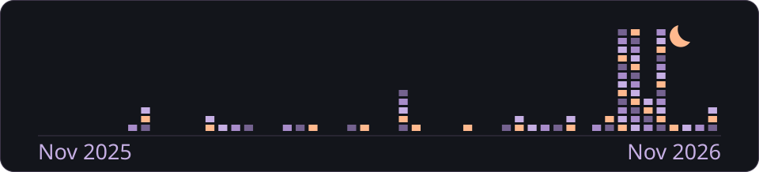

<picture>
  <source media="(prefers-reduced-motion: reduce)" srcset="assets/workshop-still.svg">
  
</picture>

I build web and mobile products, from student enrolment to real-time voice conversion.

[Portfolio](https://www.sajidur.me) · [Résumé](https://www.sajidur.me/resume) · [LinkedIn](https://www.linkedin.com/in/sajidur-rahman-sajid/) · [Email](mailto:sajidsajidurrahman99@gmail.com)

## Experience



- **Lumifi Solutions** · Full-Stack Developer. I own Applications and Enrolments for Australian training providers.
- **RemoteIntegrity** · Full-Stack Developer. I work on ERP software for business and partner operations.
- **LedgerCross** · Software Developer. I built invoice extraction, retail checkout and clinical software.
- **Bangladesh Software Solution** · Software Engineer Intern. I built frontend interfaces backed by REST APIs.

## Selected work

<p align="center">
  <a href="https://www.sajidur.me/projects/lumifi-sms"></a>
  <a href="https://www.sajidur.me/projects/voicecon"></a>
  <a href="https://www.sajidur.me/projects/aria-erp"></a>
  <a href="https://www.sajidur.me/projects/fumak-inventory"></a>
  <a href="https://www.sajidur.me/projects/invoicepilot"></a>
  <a href="https://www.sajidur.me/projects/casevault"></a>
</p>

**Live:** [VoiceCon](https://voicecon.app/) · [FUMAK](https://fumak-inventory.vercel.app/) · [CaseVault](https://casevault-bd.vercel.app/) · [CaseVault source](https://github.com/Saji-d/casevault)

## Research

[Neuro-Screen](https://www.sajidur.me/research/neuronscreen) · I built the Streamlit app and ran the leakage-controlled re-analysis for our AIUB group study. On cognitive symptom accuracy, the model performed about as well as always predicting the most common class.

## GitHub activity

<a href="https://github.com/Saji-d?tab=overview"></a>

Each building is a week. Height is scaled to the busiest week, and weeks without contributions are gaps.

<details>
<summary>Review from the cat</summary>

```diff
+ tests pass
- dinner still pending
```

</details>

<sub>Dancing cat asset via <a href="https://github.com/devsouhardo/devsouhardo/blob/main/assets/mascot.gif">Souhardo</a>.</sub>
